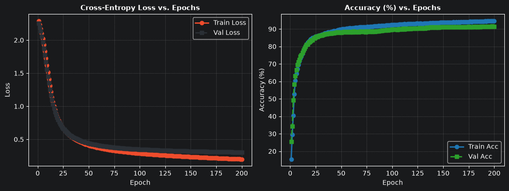

<div align="center">

# utorch


**A Minimalist Deep Learning Engine & Autograd Implemented from Scratch**

[](https://www.python.org/downloads/)
[](https://docs.astral.sh/uv/)
[](https://github.com/astral-sh/ruff)
[](https://mypy-lang.org/)
[](https://opensource.org/licenses/MIT)


<p align="center">
  <b><a href="https://adendek.github.io/utorch/">Read the Full Documentation & API Reference</a></b>
</p>


</div>


---

> **Current Branch: `feat/05-nn-framework`**
> This branch introduces the high-level, object-oriented neural network framework:
> `Parameter`, `Module`, `Linear`, `Sequential`, loss functions (`MSELoss`,
> `CrossEntropyLoss`), optimizers (`SGD`), and `DataLoader` data pipelines.


---

## Lecture Overview & Branch Progression

`utorch` is an educational implementation of automatic differentiation and deep learning primitives designed for teaching PyTorch internals from first principles.

To make the learning journey manageable, the project is structured across a sequence of focused Git branches:

| Branch | Topic | Description |
|---|---|---|
| **[feat/01-initial-repo-structure](https://github.com/adendek/utorch/tree/feat/01-initial-repo-structure)**  | **Tooling & Architecture** | Modern Python setup (`uv`), strict linting, type checks, pre-commit, and CI/CD. |
| [feat/02-forward-graphs](https://github.com/adendek/utorch/tree/feat/02-forward-graphs) | **Computational Graphs**  | DAG node abstractions, forward evaluation, and graph visualization. |
| [feat/03-scalar-autograd](https://github.com/adendek/utorch/tree/feat/03-scalar-autograd) | **Scalar Autograd**  | Reverse-mode automatic differentiation on scalar values (micrograd style). |
| [feat/04-tensor-autograd](https://github.com/adendek/utorch/tree/feat/04-tensor-autograd)| **Tensor Autograd & VJP**    | Multidimensional arrays, broadcasting, and Vector-Jacobian Products. |
| [feat/05-nn-framework](https://github.com/adendek/utorch/tree/feat/05-nn-framework) | **Neural Network Abstractions** *(Current)* | High-level API (`Module`, `Parameter`, `Loss`, `Optimizer`, and `Dataset`). |
| `feat/06-hardware-acceleration` | **GPU Acceleration** | Custom compute kernels with Triton / PyCUDA. |
| `main` | **Full Reference Build** | Fully integrated library with completed lectures, benchmarks, and examples. |

---


##  High-Level Modular Abstractions

In **Branches 1–4**, models were trained by manually managing raw weight arrays,
writing manual forward loops, and implementing custom parameter updates.

`utorch.nn` introduces the object-oriented abstractions that make PyTorch
the standard in deep learning research:

### A. `nn.Parameter`
A subclass of `Tensor` that flags numerical data as a **trainable model parameter**.
When assigned as an attribute on an `nn.Module`, it is automatically detected and
registered for optimizer updates.

### B. `nn.Module`
The base class for all neural network architectures:
* **`forward(*args, **kwargs)`**: The forward computation definition to override.
* **`__call__(*args, **kwargs)`**: Dispatches to `self.forward()`, mimicking
  PyTorch execution syntax.
* **`parameters()`**: Recursively discovers all `Parameter` instances registered
  directly, within lists/tuples, or inside nested child `Module` submodules.
* **`zero_grad()`**: Resets gradients across all registered parameters.
* **`num_parameters()`**: Computes total trainable scalar parameter count.

### C. Layers & Containers
* **`nn.Linear(in_features, out_features, bias=True)`**: Fully connected layer
  ($Y = X W^T + b$) with Kaiming uniform weight initialization.
* **`nn.ReLU()`, `nn.Sigmoid()`**: Non-linear activation modules.
* **`nn.Sequential(*layers)`**: Container cascading layer outputs into the next
  module's inputs.

### D. Loss Functions
* **`nn.MSELoss()`**: Mean Squared Error regression loss.
* **`nn.CrossEntropyLoss()`**: Multi-class classification loss with logits using
  the numerically stable LogSumExp formulation.

### E. Optimizers
* **`nn.SGD(params, lr, momentum=0.0)`**: Stochastic Gradient Descent with
  optional classical momentum.

### F. Data Pipelines (`utorch.utils.data`)
* **`TensorDataset(*tensors)`**: Packages feature and target arrays.
* **`DataLoader(dataset, batch_size, shuffle=True)`**: Streams shuffled mini-batches
  to avoid memory bottlenecks.

---

## 4. The Canonical Deep Learning Loop

With `utorch.nn`, training neural networks uses the exact same syntax as real PyTorch:

```python
import utorch as ut
import utorch.nn as nn
from utorch.utils.data import DataLoader, TensorDataset

# 1. Compose architecture
model = nn.Sequential(
    nn.Linear(784, 128),
    nn.ReLU(),
    nn.Linear(128, 10),
)

criterion = nn.CrossEntropyLoss()
optimizer = nn.Adam(model.parameters(), lr=0.005)

# 2. Standard training loop
for batch_x, batch_y in train_loader:
    optimizer.zero_grad()  # Reset parameter gradients
    logits = model(batch_x)  # Forward pass through Module DAG
    loss = criterion(logits, batch_y)  # Evaluate loss
    loss.backward()  # Reverse-mode autograd (VJP)
    optimizer.step()  # Update parameters with Adam
```

---

## 5. Lecture Experiments & Highlights

This branch includes an interactive lecture notebook ([examples/05_nn_framework.ipynb](notebooks/example_nn.ipynb))
covering two core milestones:

### 1. The Non-Linear XOR Problem
Proves that hidden representations and non-linear activations break linear
separability barriers:
* **Architecture**: `Sequential(Linear(2, 8), ReLU, Linear(8, 1))` + `MSELoss`.
* **Convergence**: Trains with `SGD` to reach loss $< 0.001$ in under 150 iterations.


### 2. MNIST Handwritten Digit Classification
Trains a deep classifier on 784-dimensional pixel arrays:
* **Architecture**: `Sequential(Linear(784, 128), ReLU, Linear(128, 10))` +
  `CrossEntropyLoss`.
* **Pipeline**: Shuffled batched loading with `DataLoader`, training vs. validation
  tracking, convergence curve plotting, and an interactive drawing canvas for
  live inference.



---

##  Getting Started

### Prerequisites
* **Python**: `3.13` or newer
* **uv**: Install via official script:
  ```bash
  # macOS / Linux
  curl -LsSf https://astral.sh/uv/install.sh | sh

  # Windows
  powershell -ExecutionPolicy ByPass -c "irm https://astral.sh/uv/install.ps1 | iex"
  ```

### Local Setup in 3 Commands

1. **Clone the repository and switch to Branch 1**:
   ```bash
   git clone https://github.com/adendek/utorch.git
   cd utorch
   git checkout feat/01-initial-repo-structure
   ```

2. **Sync the virtual environment and dependencies**:
   ```bash
   uv sync
   ```

3. **Install Git pre-commit hooks**:
   ```bash
   uv run pre-commit install --install-hooks
   ```

---

##  Development Command Reference

All commands run through `uv run` to guarantee they execute within the isolated project environment:

| Task | Command | Description |
|---|---|---|
| **Run All Hooks** | `uv run pre-commit run --all-files` | Manually triggers all pre-commit checks |
| **Serve Docs** | `uv run mkdocs serve` | Starts local documentation server at `http://127.0.0.1:8000` |
| **Run Tests** | `uv run pytest` | Executes all unit tests with verbose output |
| **Test Coverage** | `uv run pytest --cov=utorch` | Runs tests and prints coverage table |
| **Lint Code** | `uv run ruff check .` | Runs Ruff linter checks |
| **Auto-fix Lint** | `uv run ruff check . --fix` | Automatically fixes safe linting errors |
| **Format Code** | `uv run ruff format .` | Formats all code according to project style |
| **Type Check** | `uv run mypy utorch/` | Runs strict static type validation |
