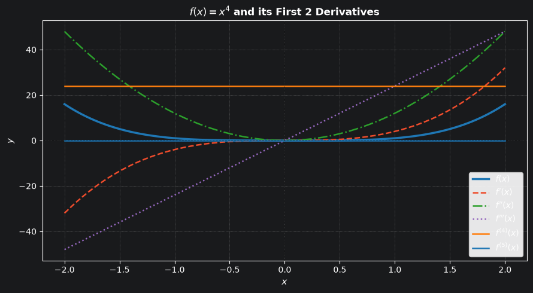

<div align="center">

# utorch


**A Minimalist Deep Learning Engine & Autograd Implemented from Scratch**

[](https://www.python.org/downloads/)
[](https://docs.astral.sh/uv/)
[](https://github.com/astral-sh/ruff)
[](https://mypy-lang.org/)
[](https://opensource.org/licenses/MIT)

</div>


---

> **Current Branch: `feat/03-scalar-autograd`**
> This branch implements scalar reverse-mode automatic differentiation (backpropagation). Because accumulated gradients are first-class `Tensor` instances, the engine dynamically builds a secondary computation tape, unlocking higher-order derivatives ($\frac{d^2 y}{dx^2}$) for free.

---

## Lecture Overview & Branch Progression

`utorch` is an educational implementation of automatic differentiation and deep learning primitives designed for teaching PyTorch internals from first principles.

To make the learning journey manageable, the project is structured across a sequence of focused Git branches:

| Branch | Topic | Description |
|---|---|---|
| **`feat/01-initial-repo-structure`**  | **Tooling & Architecture** | Modern Python setup (`uv`), strict linting, type checks, pre-commit, and CI/CD. |
| `feat/02-forward-graphs` | **Computational Graphs**  | DAG node abstractions, forward evaluation, and graph visualization. |
| `feat/03-scalar-autograd` | **Scalar Autograd**  *(Current)* | Reverse-mode automatic differentiation on scalar values (micrograd style). |
| `feat/04-tensor-autograd` | **Tensor Autograd & VJP** | Multidimensional arrays, broadcasting, and Vector-Jacobian Products. |
| `feat/05-nn-framework` | **Neural Network Abstractions** | High-level API (`Module`, `Parameter`, `Loss`, `Optimizer`, and `Dataset`). |
| `feat/06-hardware-acceleration` | **GPU Acceleration** | Custom compute kernels with Triton / PyCUDA. |
| `main` | **Full Reference Build** | Fully integrated library with completed lectures, benchmarks, and examples. |

---


## Reverse-Mode Automatic Differentiation

Unlike numerical differentiation (slow, imprecise) or symbolic differentiation (expression explosion), **reverse-mode automatic differentiation** calculates exact analytical gradients by traversing the computational Directed Acyclic Graph (DAG) in **reverse topological order**.

### The Multivariate Chain Rule
For any variable $x$ affecting the scalar output $L$ through multiple downstream children:

$$\frac{\partial L}{\partial x} = \sum_{y \in \text{children}(x)} \frac{\partial L}{\partial y} \cdot \frac{\partial y}{\partial x}$$

---

## The 5 Execution Phases of `backward()`

When you call `loss.backward()`, `utorch` executes five distinct algorithmic steps:

1. **Scalar Verification & Seed**:
   * Ensures the root is a scalar (0-D or 1-element tensor).
   * Seeds the gradient with the identity derivative: $\frac{\partial L}{\partial L} = 1.0$.
2. **Reverse Topological Sort**:
   * Uses Depth-First Search (DFS) with a visited set to order nodes so every child appears strictly before its parents.
3. **Primitive Derivative Dispatch**:
   * Inspects `node.fun` to retrieve the corresponding analytical derivative rule from `SCALAR_PRIMITIVES`.
4. **Local Chain Rule Evaluation**:
   * Evaluates the local derivative using incoming `node.grad` and parent `Tensor` inputs.
5. **Gradient Accumulation (`+=`)**:
   * Accumulates local gradient contributions into `parent.grad`.
   * **Crucial Rule**: Gradients **must accumulate via `+=`**, never overwrite (`=`), to account for multi-path dependencies (diamond graphs).

---

## Higher-Order Autograd: Gradients as Tensors

In `utorch`, derivative primitive rules return **`Tensor` instances** rather than floats. This means:
* Every gradient computation is recorded on a **secondary computational tape**.
* Calling `first_grad.backward()` calculates **second derivatives ($\frac{d^2 y}{dx^2}$)** without any manual Hessian derivations!

```python
import utorch as ut

# Let y = x^3.
# First derivative:  dy/dx   = 3x^2 -> at x=2: 12.0
# Second derivative: d2y/dx2 = 6x   -> at x=2: 12.0
x = ut.Tensor(2.0, name="x")
y = x**3

# 1. First backward pass
y.backward()
print(f"dy/dx: {x.grad.value}")  # 12.0

# 2. Second backward pass through the gradient graph
first_grad = x.grad
x.zero_grad()
first_grad.backward()
print(f"d2y/dx2: {x.grad.value}")  # 12.0
```

---

## Higher-Order Visualization (`plot_function_and_der`)

`utorch.utils.viz` includes `plot_function_and_der` to visualize $f(x)$ alongside its consecutive derivatives on a single canvas:

```python
import numpy as np
import utorch as ut
from utorch.utils.viz import plot_function_and_der

# Plots f(x) = sin(x), f'(x) = cos(x), and f''(x) = -sin(x)
plot_function_and_der(
    fun=lambda x: x.sin(),
    x_range=(-np.pi, np.pi),
    n_derivatives=2,
    title="Harmonic Cycle: $\\sin(x) \\to \\cos(x) \\to -\\sin(x)$",
)
```



---

## Lecture Experiments & Highlights

This branch includes an interactive lecture notebook ([notebooks/03_scalar_autograd.ipynb](notebooks/example_backward_scalar.ipynb)).

---

##  Getting Started

### Prerequisites
* **Python**: `3.13` or newer
* **uv**: Install via official script:
  ```bash
  # macOS / Linux
  curl -LsSf https://astral.sh/uv/install.sh | sh

  # Windows
  powershell -ExecutionPolicy ByPass -c "irm https://astral.sh/uv/install.ps1 | iex"
  ```

### Local Setup in 3 Commands

1. **Clone the repository and switch to Branch 1**:
   ```bash
   git clone https://github.com/adendek/utorch.git
   cd utorch
   git checkout feat/01-initial-repo-structure
   ```

2. **Sync the virtual environment and dependencies**:
   ```bash
   uv sync
   ```

3. **Install Git pre-commit hooks**:
   ```bash
   uv run pre-commit install --install-hooks
   ```

---

##  Development Command Reference

All commands run through `uv run` to guarantee they execute within the isolated project environment:

| Task | Command | Description |
|---|---|---|
| **Run All Hooks** | `uv run pre-commit run --all-files` | Manually triggers all pre-commit checks |
| **Serve Docs** | `uv run mkdocs serve` | Starts local documentation server at `http://127.0.0.1:8000` |
| **Run Tests** | `uv run pytest` | Executes all unit tests with verbose output |
| **Test Coverage** | `uv run pytest --cov=utorch` | Runs tests and prints coverage table |
| **Lint Code** | `uv run ruff check .` | Runs Ruff linter checks |
| **Auto-fix Lint** | `uv run ruff check . --fix` | Automatically fixes safe linting errors |
| **Format Code** | `uv run ruff format .` | Formats all code according to project style |
| **Type Check** | `uv run mypy utorch/` | Runs strict static type validation |
