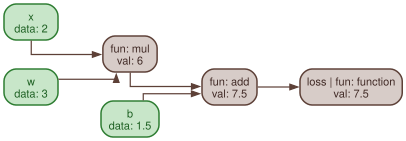

<div align="center">

# utorch


**A Minimalist Deep Learning Engine & Autograd Implemented from Scratch**

[](https://www.python.org/downloads/)
[](https://docs.astral.sh/uv/)
[](https://github.com/astral-sh/ruff)
[](https://mypy-lang.org/)
[](https://opensource.org/licenses/MIT)

</div>


---

> **Current Branch: `feat/02-forward-graphs`**
> This branch implements the core dynamic computational graph foundation: `Tensor` abstractions, operator overloading, tree-inspired Graphviz visualization, and graph complexity metrics prior to reverse-mode automatic differentiation.

---

## 1. Lecture Overview & Branch Progression

`utorch` is an educational implementation of automatic differentiation and deep learning primitives designed for teaching PyTorch internals from first principles.

To make the learning journey manageable, the project is structured across a sequence of focused Git branches:

| Branch | Topic | Description |
|---|---|---|
| **`feat/01-initial-repo-structure`**  | **Tooling & Architecture** | Modern Python setup (`uv`), strict linting, type checks, pre-commit, and CI/CD. |
| `feat/02-forward-graphs` | **Computational Graphs** *(Current)* | DAG node abstractions, forward evaluation, and graph visualization. |
| `feat/03-scalar-autograd` | **Scalar Autograd** | Reverse-mode automatic differentiation on scalar values (micrograd style). |
| `feat/04-tensor-autograd` | **Tensor Autograd & VJP** | Multidimensional arrays, broadcasting, and Vector-Jacobian Products. |
| `feat/05-nn-framework` | **Neural Network Abstractions** | High-level API (`Module`, `Parameter`, `Loss`, `Optimizer`, and `Dataset`). |
| `feat/06-hardware-acceleration` | **GPU Acceleration** | Custom compute kernels with Triton / PyCUDA. |
| `main` | **Full Reference Build** | Fully integrated library with completed lectures, benchmarks, and examples. |

---


## 2. Dynamic Computational Graphs (Define-by-Run)

In modern deep learning engines, computational graphs are not statically compiled ahead of time. Instead, they are built **dynamically at runtime** as Python executes arithmetic expressions.

Every node in `utorch` belongs to one of two fundamental categories:

1. **Leaf Nodes (Inputs, Parameters, Constants)**:
   * Created directly by the user with an explicit numerical `value`.
   * Have **no antecedent parents** (`parents = []`) and **no creator function** (`fun = None`).
   * `is_leaf` evaluates to `True`.

2. **Inner Nodes (Intermediate Operations)**:
   * Created automatically when operations (`+`, `-`, `*`, `/`, `@`, `relu`, `sin`) are executed.
   * Hold references to their **antecedent parent nodes** (`parents`) and the **generating operation** (`op = "add"`, etc.).
   * Their value is evaluated dynamically during the forward pass: $\text{value} = \text{fun}(*\text{parent\_values})$.
   * `is_leaf` evaluates to `False`.

---

## 4. Graph Visualization: The Tree Metaphor

`utorch.utils.viz` provides `draw_graph(root)` using Graphviz to render computational graphs with a nature-inspired tree palette:

* **Leaf Nodes (Inputs & Constants)**: Styled in **Leaf Green** (`#C8E6C9` with `#2E7D32` borders) displaying the variable name and numerical value.
* **Interim Nodes (Trunk & Operations)**: Styled in **Woody Brown** (`#D7CCC8` with `#5D4037` borders) displaying the operation label (`op: add`, `op: mul`, `op: matmul`) and evaluated output.

```python
from utorch import Tensor
from utorch.utils.viz import draw_graph

x = Tensor(2.0, name="x")
w = Tensor(3.0, name="w")
b = Tensor(1.5, name="b")

# Forward expression
loss = ((x * w) + b).relu()
loss.name = "loss"

# Render Directed Acyclic Graph (DAG)
dot = draw_graph(loss)
```




---

## 5. Quantitative Graph Complexity (`count_nodes`)

To analyze graph scale and memory footprints without manual counting, `count_nodes(root)` traverses the DAG with cycle-safe deduplication:

```python
from utorch.utils.viz import count_nodes

stats = count_nodes(loss)
print(stats)
# GraphStats(total=6, leaves=3, interim=3, edges=5, ops={'mul': 1, 'add': 1, 'relu': 1})
```

* **`stats.leaves`**: Count of distinct input nodes and constants (reused inputs are counted once).
* **`stats.interim`**: Total operations performed in the graph.
* **`stats.edges`**: Total directed dependency links.
* **`stats.ops`**: Frequency dictionary of every mathematical operation.

---

## 6. Lecture Experiments & Highlights

This branch includes an interactive lecture notebook ([notebooks/02_forward_graphs.ipynb](notebooks/example_forward_graph.ipynb)) covering five core pedagogical experiments:


---

## 7. Getting Started

### Prerequisites
* **Python**: `3.13` or newer
* **uv**: Install via official script:
  ```bash
  # macOS / Linux
  curl -LsSf https://astral.sh/uv/install.sh | sh

  # Windows
  powershell -ExecutionPolicy ByPass -c "irm https://astral.sh/uv/install.ps1 | iex"
  ```

### Local Setup in 3 Commands

1. **Clone the repository and switch to Branch 1**:
   ```bash
   git clone https://github.com/adendek/utorch.git
   cd utorch
   git checkout feat/01-initial-repo-structure
   ```

2. **Sync the virtual environment and dependencies**:
   ```bash
   uv sync
   ```

3. **Install Git pre-commit hooks**:
   ```bash
   uv run pre-commit install --install-hooks
   ```

---

## 5. Development Command Reference

All commands run through `uv run` to guarantee they execute within the isolated project environment:

| Task | Command | Description |
|---|---|---|
| **Run All Hooks** | `uv run pre-commit run --all-files` | Manually triggers all pre-commit checks |
| **Serve Docs** | `uv run mkdocs serve` | Starts local documentation server at `http://127.0.0.1:8000` |
| **Run Tests** | `uv run pytest` | Executes all unit tests with verbose output |
| **Test Coverage** | `uv run pytest --cov=utorch` | Runs tests and prints coverage table |
| **Lint Code** | `uv run ruff check .` | Runs Ruff linter checks |
| **Auto-fix Lint** | `uv run ruff check . --fix` | Automatically fixes safe linting errors |
| **Format Code** | `uv run ruff format .` | Formats all code according to project style |
| **Type Check** | `uv run mypy utorch/` | Runs strict static type validation |
